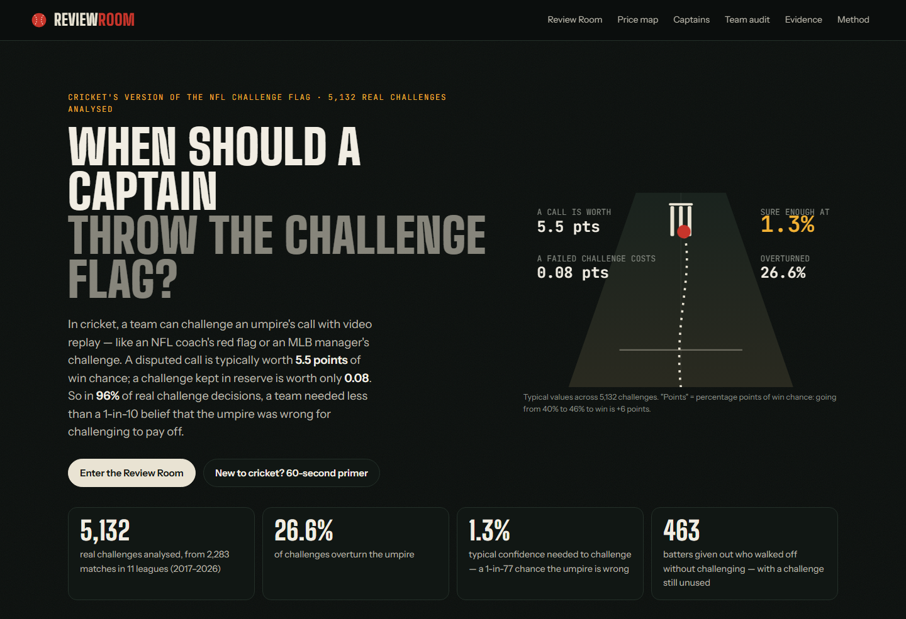
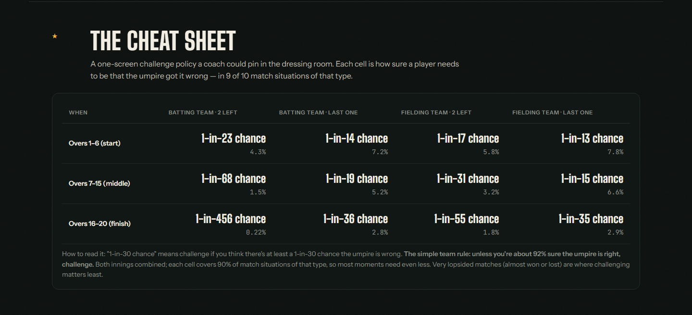
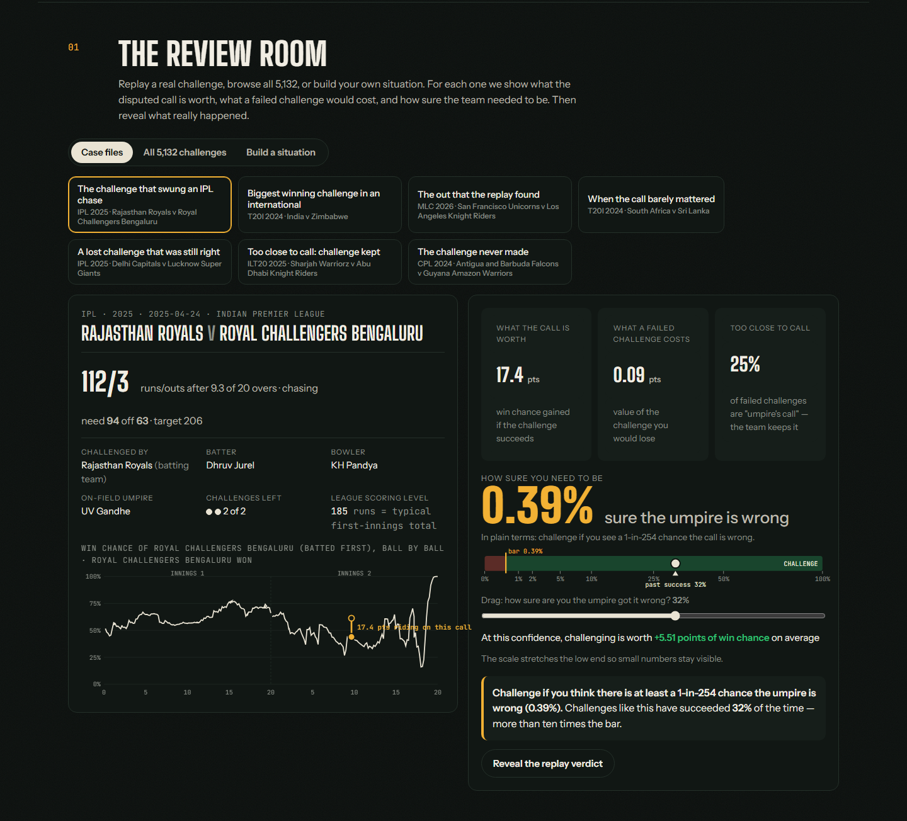

# Review Room: when should a cricket team challenge the umpire?

**Live app:** https://ayushgade06.github.io/review-room/
**Built for:** AQX Sports Analytics Data Bowl 4.0



## The idea in 30 seconds

In cricket, a team can **challenge an umpire's call with video replay**. It works like an **NFL coach's red flag**, an **MLB manager's challenge**, or a **tennis Hawk-Eye challenge**. Cricket calls it **DRS**, the Decision Review System.

Challenges are limited, so every one is a small bet:

> **Risk a challenge you might need later, to fix a call that might cost you the game.**

We measured both sides of that bet for **5,132 real challenges** from 11 professional T20 leagues (2017–2026), in the same unit TV broadcasts use: **win chance**.

| | Typical value |
|---|---|
| What a disputed call is worth | **5.5 points** of win chance |
| What a failed challenge costs | **0.08 points** |
| How sure a team needs to be to challenge | **1.3%**, about a 1-in-77 chance the umpire is wrong |

A "point" means one percentage point: if a team goes from 40% to 46% to win, that's +6 points.

**The finding:** a challenge is cheap and a call is expensive. In 96% of real decisions, a team needed less than a 1-in-10 belief that the umpire was wrong. Teams don't challenge nearly as freely as that. 463 batters walked off "out" without challenging while their team still had a challenge left.

## New to cricket? Four things to know

1. **A wicket is an out.** Each team bats once, for up to 120 balls, and is done after 10 outs. Losing a batter early is like an out with the bases loaded.
2. **The umpire calls it on the spot:** "out" or "not out". The most disputed calls are **LBW** (the ball hit the batter's leg when it would have hit the stumps) and thin catches.
3. **Either team can challenge.** The batting team challenges an "out"; the fielding team challenges a "not out". Video and ball-tracking decide.
4. **Challenges are limited:** two failed challenges per team per innings in most leagues. If the replay is too close to call ("**umpire's call**"), the original decision stands, but the team **keeps** its challenge.

## Who it helps, and how

| Who | The decision | What Review Room gives them |
|---|---|---|
| **Captain or coach** | "Do we challenge this?", decided in about 15 seconds | A pre-agreed rule: the **cheat sheet** below |
| **Team analyst** | "Are we using our challenges well?" | Every challenge replayed, plus a team-by-team ledger of win chance gained |
| **Broadcaster** | "Should they challenge?" | An instant, explainable number for any situation |



**The simple team rule:** unless you're about 92% sure the umpire is right, challenge. You need to be pickier early in the innings and with your last challenge. The cheat sheet shows exactly how much.

## What's in the app

1. **New to cricket?** The four ideas above, in the app itself.
2. **The cheat sheet.** One table a coach could pin in the dressing room.
3. **The Review Room.** Replay a real challenge, browse all 5,132, or build your own situation. You see:
   - the match's win-chance line (like a TV win-probability graph), with what was riding on the call;
   - what a failed challenge would cost;
   - how sure the team needed to be.

   Drag the slider to set your own confidence, then reveal the real replay verdict.

   
4. **The price of a challenge.** A heat map of how sure you need to be, for every over and match situation.
5. **Do teams challenge enough?** Success rates compared with the bar, the "last challenge" effect, and the batters who never challenged.
6. **Team audit.** How much win chance each team has gained from its own challenges.
7. **Can you trust the numbers?** How the model was tested on matches it had never seen.

## How it works, in plain English

1. **Win chance after every ball.** We trained a model on 8,897 matches to estimate each team's chance of winning at any moment, from the score, balls left, outs and the league's scoring level. It's the same idea as the win-probability line on an NFL or NBA broadcast.
2. **What the call is worth.** Compare the win chance if the batter is out with the win chance if they're not out. The gap is what a successful challenge wins.
3. **What a failed challenge costs.** A challenge you lose is one you can't use later. We measured how much win chance teams typically gain later from the challenges they still hold. The answer is very little, because late-innings howlers are rare and you usually have a second challenge.
4. **The decision.** Challenge if *your confidence × what the call is worth* is bigger than *your doubt × what a lost challenge costs*. That gives the "how sure you need to be" number.

**How we checked it.** The model learned from matches before 2024 and was graded on **2,813 matches from 2024–26 it had never seen**, like back-testing on future seasons.
- It beat a standard textbook model in both innings.
- When it says 70%, teams win about 70% of the time.
- It survives tougher assumptions: even if a saved challenge were worth 3× our estimate, 81% of decisions still needed less than 1-in-10 confidence.

**Two honest lessons:**
- Our first model failed on recent IPL matches, because the league now scores far more runs than ever before. Measuring runs against each league's recent "par" fixed it. It's like judging an NBA team's points against that season's pace.
- We tried to predict which challenges succeed from the match situation, and **couldn't**. The answer depends on the ball itself, which the player sees and our data doesn't. So the app asks for the player's confidence instead of pretending to know it.

Full details, including every test and limitation, are in [docs/METHODOLOGY.md](docs/METHODOLOGY.md).

## Limitations

- **Invisible calls.** We only see challenges that were made, not calls nobody challenged.
- **No ball-tracking data.** The player's own read of the ball is the missing ingredient, which is why the user supplies it.
- **Value depends on habits.** "What a failed challenge costs" is measured from how teams challenge today.
- **Situation, not player.** Win chance depends on the match situation, not on who is batting.
- **Estimates, not proof.** These are estimates and patterns, not proof of cause and effect.

## Run it yourself

The app is a static web page: no installs, no API keys, no build step.

```bash
cd web
python -m http.server 8000      # then open http://localhost:8000
```

To rebuild every number from the raw data (about 10 minutes) and run the tests:

```bash
pip install -r requirements.txt
python pipeline/parse.py        # read the raw match files
python pipeline/wp.py           # train and test the win-chance model
python pipeline/drs.py          # price every challenge, export app data
python -m pytest -q tests/      # 7 tests: data parsing, challenge counting, the decision maths
node --test tests/engine.test.mjs   # 4 tests: the in-browser maths matches the Python results
```

## What's in the repository

```
web/        the app (index.html, styles.css, app.js, engine.js) and its data
pipeline/   parse.py (raw data → tables), wp.py (win-chance model), drs.py (challenge maths)
tests/      automated tests (Python + JavaScript)
data/raw/   the exact Cricsheet match files used (29 Oct 2026)
docs/       research, methodology, data sources, demo script, submission text, screenshots
```

**More reading:**
- [Research & why we picked this idea](docs/RESEARCH.md)
- [Methodology](docs/METHODOLOGY.md)
- [Data sources & licences](docs/DATA_SOURCES.md)
- [90-second demo script](docs/DEMO_SCRIPT.md)
- [Submission text](docs/SUBMISSION.md)

## Licence and credit

- **Code:** MIT ([LICENSE](LICENSE)).
- **Data:** contains information from [Cricsheet](https://cricsheet.org/), made available under the [ODC Attribution License 1.0](https://opendatacommons.org/licenses/by/1-0/) ([LICENSE-DATA.md](LICENSE-DATA.md)).
- Not affiliated with Cricsheet, the ICC or any league.
- No third-party code was copied. The charts are hand-built.
